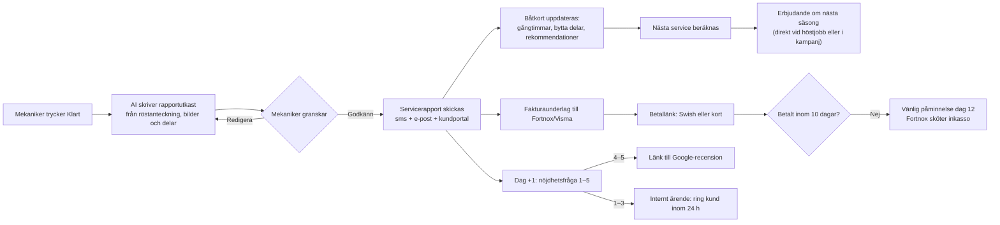
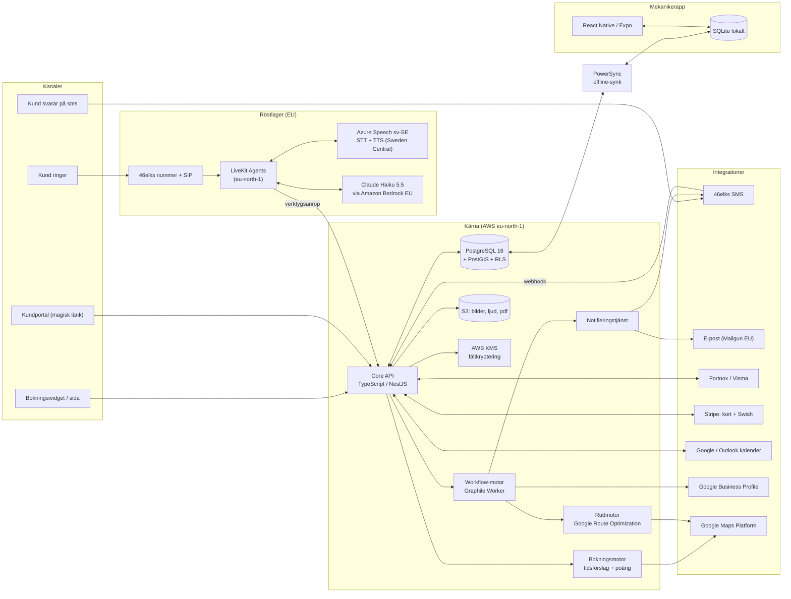
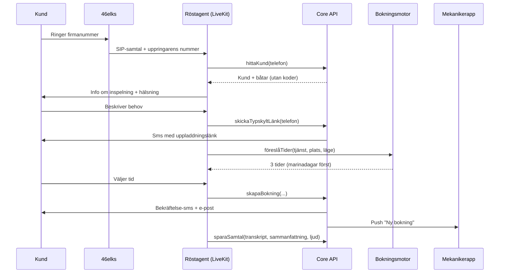
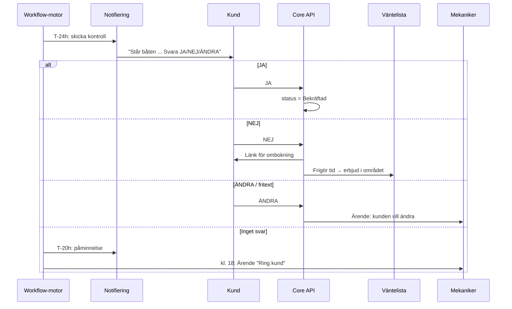
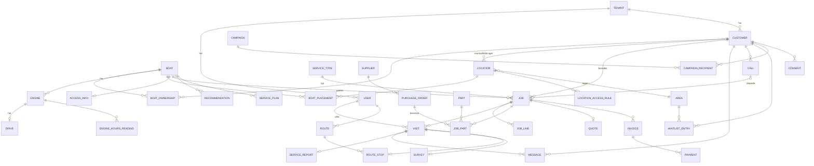

# Lösningsförslag: allt-i-ett-system för ambulerande båtmekaniker, del 1 av 2

*Arbetsnamn: **Bojen***

---

## 1. Sammanfattning

Bojen är en mobilanpassad SaaS-tjänst för båtmekaniker som åker ut till kunderna och driver sin verksamhet ensamma eller med upp till fem mekaniker. Bokning, CRM, kundkommunikation och uppföljning ligger i samma system, och utgångspunkten är **båten**, inte kunden. Mekanikern ska kunna arbeta med telefonen i ena handen och en skiftnyckel i den andra.

Systemet bygger på fyra idéer:

1. **Ingen förfrågan ska gå förlorad.** En AI-receptionist på svenska svarar dygnet runt. Den samlar in uppgifter om båt, motor, plats och åtkomst, bokar direkt i lediga tider och skickar vidare akuta haverier till mekanikern.
2. **Bokningen tar hänsyn till var jobben ligger.** Varje tänkbar tid får en poäng utifrån hur mycket extra körning den ger. Tider i marinor där mekanikern redan har jobb visas först och kan ge kunden rabatt. Målet är fler jobb per marinabesök och mindre tid i bilen.
3. **Båten ska vara tillgänglig när mekanikern kommer.** Kunden behöver inte vara på plats, men båten måste vara det. Dagen innan kontrollerar systemet via sms att båten ligger där den ska, i sjön eller på land, och att nyckel och kod finns. Det tar bort den dyraste förlusten i branschen: att åka ut i onödan. En avbokad tid erbjuds direkt till väntelistan i samma område.
4. **Säsongen fylls i förväg.** Under vintern skickar systemet riktade utskick till förra årets kunder och föreslår samma vecka som då. Målet är att våren är 60–70 % förbokad innan isen har gått upp.

Mekanikern arbetar i en app som fungerar offline i skärgården. Servicerapporten tar några minuter att göra: mekanikern pratar in vad som gjorts, tar bilder och bockar av delar, så skriver AI:n rapporten. Fakturan går till Fortnox eller Visma och betalning sker med Swish eller kort.

Tjänsten har flera kunder i samma installation (multi-tenant) och all data lagras inom EU, i första hand i AWS-regionen Stockholm (eu-north-1). Personuppgifter hanteras enligt GDPR. Koder och nyckelinformation krypteras och visas bara för den mekaniker som har jobbet, och bara samma dag.

**Effektmål för en enmansfirma:** 8–12 timmar mindre administration per vecka i högsäsong, 15–25 % fler jobb per vecka genom bättre klustring och mindre körning, under 2 % bortfall för att båten inte var tillgänglig (branschen ligger troligen på 5–10 %) och förbokningsgrad för våren på över 60 % den 1 mars.

---

## 2. Antaganden

| # | Område | Antagande |
|---|---|---|
| A1 | Geografi | Första marknaden är **Stockholms skärgård** (Värmdö, Nacka, Vaxholm, Österåker, Norrtälje och Haninge). Västkusten kommer i steg 2. |
| A2 | Företagsstorlek | Målgruppen är firmor med 1–5 mekaniker, i snitt 1,6. Ungefär 70 % är enmansföretag. |
| A3 | Ankomst | Jobben bokas i **tidsfönster** (08–12, 12–16 och 16–19 sommartid), inte på exakta klockslag. Kunden behöver inte vara där. |
| A4 | Åtkomst | Ungefär 85 % av jobben kan nås med bil. Övriga kräver egen båt eller färja. Därför behöver varje plats ett åtkomstsätt (*bil*, *egen båt* eller *färja*) och en tid för överfart. |
| A5 | Prisnivå 2026 (Stockholm) | Timpris 850–1 150 kr exklusive moms. Framkörning 495–895 kr per besök. Akuttillägg 50–100 % eller fast 1 500–2 500 kr på kvällar och helger. Privatkunder ser priser inklusive moms. |
| A6 | Typiska tider | Årsservice utombordare 1,5–2,5 h. Årsservice inombordare med drev 3–5 h. Vinterkonservering 2–4 h. Impellerbyte 1–2 h. Bälgbyte 4–6 h (kräver att båten står på land). Kontroll inför köp 2–3 h. |
| A7 | Krav på läge | Varje tjänst har ett krav på läge: *i sjön*, *på land* eller *spelar ingen roll*. Bälgbyte och bottenrelaterade jobb kräver land. Provkörning kräver sjö. |
| A8 | Varvens scheman | Marinornas scheman för sjösättning och upptagning finns inte digitalt. De matas in manuellt per marina, eller så anger kunden sitt datum. |
| A9 | Påminnelse vid uteblivet svar | **X = 4 timmar.** Får systemet inget svar skickas en andra påminnelse, och om även den blir obesvarad skapas ett ärende senast kl. 18 dagen innan. |
| A10 | Kampanjperioder | Vårkampanjen går 10 januari–28 februari. Höstkampanjen går 5–31 augusti. |
| A11 | Sms och å, ä, ö | Sms med å, ä eller ö kodas som UCS-2. Då ryms bara **70 tecken per segment**, eller 67 tecken när meddelandet delas upp i flera segment. Meddelandetexterna är skrivna med detta i åtanke. |
| A12 | Svar på sms | Kunderna ska kunna svara, så utgående sms skickas från ett **svenskt nummer som tar emot svar**, ett per firma. De skickas inte med alfanumeriskt avsändarnamn. |
| A13 | Fakturering | Fortnox är vanligast bland målgruppen, därefter Visma eEkonomi. Faktura med 10 dagars betalningstid är standard för privatkunder, och Swish används som alternativ på plats. |
| A14 | Haverier på sjön | Mekanikern är **inte** en räddningstjänst. Vid fara hänvisar AI:n till 112 och vid bogsering till Sjöräddningssällskapet. |
| A15 | Inspelning | Samtal spelas bara in efter att kunden har fått information i början av samtalet. Ljudet sparas i 90 dagar och transkriberingen i 24 månader. Detta fördjupas i del 2. |
| A16 | ROT | ROT-avdrag gäller inte för båtar och finns inte med någonstans i systemet. |

---

## 3. Användarresor

### 3.1 Haveri en lördag

**Situation:** Lördag 12 juli kl. 14:20. Anna (ny kund) ligger vid gästbryggan i Sandhamn med en Buster Magnum med en Yamaha F115. Motorn går upp i varv men båten rör sig inte. Mekanikern Jonas är ledig.

| Tid | Vad som händer | System |
|---|---|---|
| 14:20 | Anna ringer Jonas firmanummer. AI:n svarar: *”Hej, du har kommit till Jonas Båtservice. Jag är en digital assistent och samtalet spelas in för att vi ska kunna hjälpa dig. Vad gäller det?”* | Telefonnumret finns inte i registret, så kunden behandlas som ny. |
| 14:21 | AI:n frågar först om säkerheten: *”Är någon i fara eller driver båten?”* Anna svarar att båten är förtöjd och att ingen är i fara. | Om svaret är ja: *”Ring 112 direkt.”* Vid behov av bogsering hänvisar AI:n till Sjöräddningssällskapet. |
| 14:22 | AI:n frågar efter båt, motor, plats och symtom. Hon berättar att motorn går upp i varv men inte driver båten. AI:n frågar om propellern har gått i något, och Anna tror att hon slog i en sten. | Jobbet klassas som **akut, i sjön**, med misstänkt skadad propeller eller slirande nav. |
| 14:24 | AI:n berättar att det är helgakut och vad det kostar: *”Akuttillägget är 1 800 kronor plus ordinarie timpris. Vill du att jag frågar Jonas?”* Anna svarar ja. | Firmans regel: helgakut ska godkännas manuellt. |
| 14:24 | AI:n skickar sms med länk för bilder (*”Skicka gärna en bild på propellern och motorns typskylt”*) och avslutar: *”Jonas får ett meddelande nu. Du får svar inom 30 minuter.”* | Jonas får en notis i appen med ljud för akutärende och knapparna **Ta jobbet**, **Ring upp** och **Avböj**. |
| 14:31 | Jonas läser sammanfattningen och tittar på bilderna, där propellern syns skadad. Han trycker på **Ta jobbet**, väljer ”17–19” och skriver ”ta med reservprop 13 1/4 x 17”. | Bokningen skapas. Kunden får ett sms med tidsfönster och pris. |
| 17:40 | Jonas tar egen båt från Stavsnäs. Appen visar en checklista med de delar som behövs och vilka av dem som finns i servicebilen. | Status: **på väg**. Anna får ett sms om att han är på väg. |
| 18:30 | Propellern är bytt och båten är provkörd. Jonas pratar in en kort anteckning och tar två bilder. | AI:n skriver servicerapporten. Fakturaunderlaget inklusive akuttillägget går till Fortnox. Anna får en Swish-länk. |
| Söndag 10:00 | Nöjdhetsfrågan skickas. Anna ger betyget 5 och får en länk till Google-recension. | Kunden, båten och motorn är nu registrerade. Båten är märkt som *ny kund – erbjud årsservice i höst*. |

**Om Jonas inte svarar inom 30 minuter** skickar AI:n ett sms till Anna: *”Jonas kan tyvärr inte ta jobbet i kväll. Vill du ha första tid i morgon? Svara JA.”* Har firman flera mekaniker går ärendet i stället vidare till nästa mekaniker som har jour.

---

### 3.2 Vinterkonservering bokad på webben

**Situation:** Måndag 25 augusti. Per har en Nimbus 305 Coupé med Volvo Penta D4-300 och drev DPH. Båten tas upp vid Bullandö Marina den 14 oktober. Per klickar på länken i höstkampanjens sms.

1. **Tjänst:** Länken öppnar bokningssidan med tjänsten *Vinterkonservering inombordare med drev* förvald. Per identifieras med engångskod via sms, eftersom länken är personlig.
2. **Båt:** Båten är redan ifylld från registret (”Nimbus 305, D4-300, 612 h vid förra besöket”). Per anger att gångtimmarna nu är cirka 680.
3. **Plats:** Förslaget är *Bullandö Marina, uppställning på land*. Systemet frågar när båten tas upp, och Per anger den 14 oktober. Tider före det datumet visas inte, eftersom tjänsten kräver att båten står på land.
4. **Tid:**
   - **Onsdag 22 oktober, 08–12**, märkt *”Mekanikern är på Bullandö denna dag, framkörning 0 kr (spara 695 kr)”*
   - Torsdag 23 oktober, 12–16, med vanlig framkörning
   - Måndag 27 oktober, 08–12, märkt *”Bullandö-dag, framkörning 0 kr”*
5. **Delar:** Tjänsten innehåller standardsatsen (oljor, filter, impeller och zinkanoder). Delarna finns i lager, så tiderna påverkas inte. Per lägger till *byte av bälgar på drevet*. Systemet ser att bälgsatsen har fem dagars ledtid, vilket inte påverkar tiderna eftersom det är mer än fem dagar kvar.
6. **Åtkomst:** Nyckeln finns i marinans nyckelskåp, och Per anger en kod (som krypteras). Han laddar upp en bild på drevet.
7. **Bekräftelse:** Jonas har valt automatisk bekräftelse för befintliga kunder. Per får sms och e-post direkt. Delarna läggs på leverantörsbeställningen för vecka 42.
8. **24 timmar innan:** Ett sms frågar om båten står på land på Bullandö och om nyckeln finns i skåpet. Per svarar JA och bokningen blir **bekräftad**.

---

### 3.3 Mekanikerns dag i högsäsong: fem jobb i två marinor

**Tisdag 6 maj. Jonas startar i Gustavsberg.**

| Tid | Plats | Jobb | Vad appen gör |
|---|---|---|---|
| 06:45 | Hemma | Morgonvy | Dagens rutt visas med fem jobb, alla bekräftade (grön bock). Körtid totalt 1 h 10 min. Plocklistan säger att impeller för Mercury 47-43026 saknas i servicebilen och finns att hämta på vägen hos Watski Proffs i Gustavsberg. Kunderna får sms med ungefärlig ankomsttid kl. 07:00. |
| 07:30–09:30 | **Bullandö** | 1. Årsservice, Yamaha F150 (i sjön) | Jonas trycker **Starta**. Grindkoden visas, men bara nu. Han fyller i gångtimmar (412 h), bockar av delar från servicebilens lager med ett tryck per del, tar tre bilder och trycker **Klart**. |
| 09:35–11:30 | Bullandö | 2. Impellerbyte, Volvo Penta 5.0 GXi | Bryggplats B14 visas på marinans karta. Delen hämtades på morgonen. Han pratar in: *”Impeller hade två vingar av, rekommenderar byte av pumphus nästa år.”* Det blir en rekommendation för nästa säsong på båtkortet. |
| 11:35–13:00 | Bullandö | 3. Felsökning, Suzuki DF90 | Jonas ser att felet kräver en ny bränslepump. Han skapar en offert i appen med pump och 1 h arbete, och kunden godkänner via sms. Delen beställs med ett tryck och ett nytt besök läggs preliminärt nästa Bullandö-dag. |
| 13:00–13:40 | – | Lunch och körning (25 min) | Utan täckning på vägen sparas allt lokalt i appen. |
| 13:40–15:40 | **Djurö Båtvarv** | 4. Sjösättningsförberedelse, Mercury 250 Verado (på land) | Ingen täckning på varvet. Appen arbetar offline: bilder, delar och anteckningar köas. |
| 15:45–17:15 | Djurö | 5. Årsservice, Honda BF60 | Kunden har skrivit i bokningen att båten stod längre in i hallen. Det syns som en röd notis högst upp i jobbet. |
| 17:30 | Bilen | Synk | Allt synkas när täckningen kommer tillbaka. Fem servicerapporter ligger som utkast. Jonas granskar och skickar dem på fem minuter. Fakturorna går till Fortnox. |
| 17:35 | – | Kvällssummering | 9,5 fakturerbara timmar och 1 h 10 min körning (11 %). Imorgon: fyra jobb, alla bekräftade. |

**Om något ändras under dagen:** Om jobb 3 drar över visar appen *”Jobb 4 och 5 riskerar att bli sena. Skicka ny ankomsttid?”* Med ett tryck får kunderna ett sms.

---

### 3.4 Flödet efter jobbet

**Exempel:** Efter en vinterkonservering i oktober får kunden i samma rapport frågan *”Vill du boka vårservice och sjösättningskontroll samma vecka som i år, v. 17? Svara JA.”* Ungefär 30–40 % av kunderna brukar tacka ja redan här, och då behöver de inte nås av vårkampanjen.

---

### 3.5 Januari: att fylla vårsäsongen

**Måndag 12 januari. Jonas sitter vid köksbordet med datorn.**

1. **Prognosen** visar att 38 % av kapaciteten mars–maj är förbokad. Samma dag förra året var det 31 %. Vecka 17–19 är fullbokade, medan vecka 12–14 bara är fyllda till 15 %.
2. **Kampanjguiden** föreslår *Vårkampanj 2027*:
   - Segment A: kunder som hade vårservice 2026 och inte har bokat än (142 båtar).
   - Segment B: kunder med vinterkonservering hösten 2026 men utan vårservice (38 båtar).
   - Segment C: båtar där tiden till nästa service enligt gångtimmar har gått ut (21 båtar).
3. **Förslag på tider:** Systemet hittar varje kunds tid från förra året och lägger reservationer på samma vecka, grupperat per marina. Till exempel får alla 31 båtar på Bullandö förslag på tisdagar och onsdagar i vecka 15–16.
4. **Lågsäsongsrabatt:** Jonas lägger till 10 % rabatt på arbetet för vecka 12–14 för att jämna ut kapaciteten. Systemet erbjuder i första hand dessa veckor till båtar som står inomhus eller i hall.
5. **Utskick:** Kampanjen skickas i omgångar, 40 sms per dag tisdag till torsdag kl. 18:30, så att svaren kommer in i en takt som går att hantera.
6. **Svar:** När en kund svarar JA bokas båten direkt i den föreslagna tiden. ”ANNAN TID” ger en bokningslänk. Den som inte svarar på sju dagar får en påminnelse via e-post, och efter 14 dagar släpps reservationen.
7. **Marinor:** Jonas skickar ett mejl via systemet till hamnkaptenen på Djurö Båtvarv och föreslår *”servicedag på Djurö 16 april”*. Varvet lägger ut erbjudandet i sitt medlemsbrev. 11 nya båtar bokar via varvets egen länk och märks med kanal *Djurö Båtvarv*.
8. **Resultat 28 februari:** Förbokningsgraden för våren är 64 %. Fem kunder har skrivit att de har sålt båten, och de markeras som *båt såld*. Fråga om den nya ägaren skapas.

---

## 4. Funktionsspecifikation

**Prioritering:** M = måste finnas i första versionen (MVP), B = bör finnas i version 1.x, K = kan komma senare.

### 4.1 Modul R: Virtuell receptionist (AI-röst)

| ID | User story | Acceptanskriterier | Prio |
|---|---|---|---|
| R1 | Som **båtägare** vill jag att någon svarar när jag ringer, oavsett tid, så att jag inte behöver ringa runt. | Svar inom 2 ringsignaler dygnet runt. Svenskt tal, svarstid under 1,2 s (p90). Informationen om inspelning läses alltid upp först. Säger kunden nej till inspelning sparas bara en sammanfattning. | M |
| R2 | Som **mekaniker** vill jag att AI:n samlar in allt jag behöver så att jag slipper ringa tillbaka. | Obligatoriska fält: namn, mobilnummer, båtens märke och modell, motorns märke, typ (inombordare eller utombordare), plats, läge (sjö eller land), jobb och hur brådskande det är. Valfria fält: längd, motormodell, årsmodell, drev, gångtimmar och åtkomst. AI:n frågar igen om det som saknas (högst två gånger). Fält som AI:n är osäker på får en markering. | M |
| R3 | Som **återkommande kund** vill jag bli igenkänd. | Telefonnumret matchas mot kundregistret. AI:n hälsar med förnamn och frågar *”Gäller det Nimbusen på Bullandö?”* Har kunden flera båtar får kunden välja. AI:n läser aldrig upp koder eller adresser. | M |
| R4 | Som **båtägare** vill jag kunna boka direkt i samtalet. | AI:n föreslår högst tre tider från samma tjänst för tidsförslag som webben använder, med marinadagar först. Bokningen skapas med status *Bekräftad* eller *Väntar på godkännande* enligt firmans inställning. Bekräftelse-sms skickas inom 60 s. | M |
| R5 | Som **mekaniker** vill jag ha en bild på typskylten. | Ett sms med uppladdningslänk skickas under samtalet. När bilden kommer in läser AI:n av modell och serienummer, och mekanikern godkänner med ett tryck. | M |
| R6 | Som **mekaniker** vill jag att akuta ärenden och osäkra fall går vidare till mig. | Akutregler går att ställa in per firma: koppla vidare, notis med tidsgräns eller meddelande. Ord som ”haveri”, ”tar in vatten” och ”driver” ger säkerhetsfrågan först. Om AI:n är osäker i mer än två försök tar den ett meddelande. | M |
| R7 | Som **mekaniker** vill jag kunna läsa samtalet i efterhand. | Transkribering, sammanfattning i 5 punkter och ljud finns på kundkortet. Ett ärende eller förslag skapas i pipelinen. | M |
| R8 | Som **ägare** vill jag bestämma vad AI:n får lova. | Prislista, akuttillägg, områden som inte täcks (till exempel ”vi åker inte till Arholma”) och tjänster som inte erbjuds går att ställa in. AI:n lovar aldrig priser utanför prislistan. | M |
| R9 | Som **båtägare** vill jag kunna skicka sms i stället för att ringa. | Samma agent hanterar sms-dialog på firmanumret. | B |
| R10 | Som **ägare** vill jag ha ett eget namn och en egen röst på receptionisten. | Val mellan 3 röster, egen hälsningsfras och eget namn på assistenten. | K |

### 4.2 Modul W: Bokning på webben

| ID | User story | Acceptanskriterier | Prio |
|---|---|---|---|
| W1 | Som **mekaniker** vill jag bädda in bokningen på min webbplats. | En rad kod (`<script>` som web component) och en fristående sida på `boka.bojen.se/{firma}`. Egen färg och logga. Fungerar på mobil i 360 px bredd. Laddar på under 2 s på 4G. | M |
| W2 | Som **båtägare** vill jag välja tjänst och båt enkelt. | Steg: tjänst → båt (sms-kod för befintlig kund, annars nytt formulär med märkeslistor) → plats (marina ur listan, karta eller adress) → läge och datum för sjösättning eller upptagning → tid → bilder → bekräfta. Högst 6 steg. | M |
| W3 | Som **båtägare** vill jag se tider som passar platsen. | Tider räknas fram utifrån kalender, plats, tjänstens längd och krav på läge. Marinadagar sorteras först och märks med rabatten. Tider där extra körning överstiger firmans gräns (till exempel 45 min) visas inte. | M |
| W4 | Som **mekaniker** vill jag inte boka jobb jag saknar delar till. | Om en del inte finns i lager och har ledtid L dagar visas tider tidigast från idag + L + 1 dag. Alternativet är att boka preliminärt: tiden reserveras och bekräftas när delarna har kommit. | B |
| W5 | Som **mekaniker** vill jag välja automatisk eller manuell bekräftelse. | Kan ställas in per tjänst och kundtyp (till exempel automatiskt för befintliga kunder, manuellt för nya kunder och akutjobb). En manuell bokning blir *Förfrågan* och mekanikern godkänner med ett tryck i appen. | M |
| W6 | Som **båtägare** vill jag kunna boka om själv. | Länken i bekräftelsen öppnar en sida för ombokning och avbokning. Avbokning är gratis fram till 48 h innan (inställbart). Den frigjorda tiden går till flödet för väntelistan. | M |
| W7 | Som **marina** vill jag ha en egen bokningslänk. | Länken `boka.bojen.se/{firma}/m/{marina}` har marinan förvald. Kanalen sparas på kunden. | B |

**Hur tidsförslagen räknas fram (gemensamt för röst och webb):**

- För varje tänkbar dag och tidsfönster räknas *extra körtid* ut, alltså hur mycket längre dagens rutt blir om jobbet läggs in.
- **Poäng = extra körtid (min) × 1,0 − marinabonus (30 om mekanikern redan är i marinan) + väntetid till tiden i dagar × 2**
- De tider som har lägst poäng visas först.
- Rabatten för marinadagar (till exempel att framkörningen stryks) är en inställning per firma.

### 4.3 Modul P: Bekräftelser och påminnelser

| ID | User story | Acceptanskriterier | Prio |
|---|---|---|---|
| P1 | Som **båtägare** vill jag få en tydlig bekräftelse. | Sms och e-post inom 60 s med datum, tidsfönster, plats, jobb, förberedelser för just den tjänsten och länk för ombokning. | M |
| P2 | Som **mekaniker** vill jag veta att båten är tillgänglig. | Sms 24 h innan (aldrig mellan 21 och 08; flyttas till 18:00 dagen innan). Svaren JA, NEJ och ÄNDRA tolkas, och även ”ja”, ”Ja!”, ”j”, 👍 och fria svar via AI. | M |
| P3 | Som **mekaniker** vill jag att uteblivna svar hanteras. | Andra sms efter 4 h. Om inget svar har kommit kl. 18 dagen innan skapas ärendet *Ring kund*. Bokningen ligger kvar men märks med gul status. | M |
| P4 | Som **mekaniker** vill jag att avbokade tider fylls automatiskt. | Svarar kunden NEJ skickas ett erbjudande till väntelistan i samma område, till högst 5 kunder åt gången. Den som svarar JA först får tiden, och de övriga får ”tiden är tyvärr tagen”. | M |
| P5 | Som **båtägare** vill jag veta ungefär när mekanikern kommer. | Sms kl. 07 samma dag med ett fönster på ±1 h. Valfritt sms ”på väg” när mekanikern startar jobbet före. | M |
| P6 | Som **båtägare** vill jag få en servicerapport. | E-post med pdf och webbversion: arbete, bilder, delar med artikelnummer, gångtimmar, rekommendationer med prioritet (åtgärda nu, nästa säsong eller håll koll) och prisindikation. | M |
| P7 | Som **ägare** vill jag att allt loggas. | Alla meddelanden syns i tidslinjen på kund- och båtkortet, med status levererad, läst eller misslyckad. | M |

### 4.4 Modul C: CRM med båten i centrum

| ID | User story | Acceptanskriterier | Prio |
|---|---|---|---|
| C1 | Som **mekaniker** vill jag se allt om en båt på en skärm. | Båtkortet visar bild, båt, motor eller motorer, drev, serienummer, var båten står på sommaren och vintern, åtkomst (maskerad), servicehistorik, mätningar av gångtimmar, öppna rekommendationer och nästa service. | M |
| C2 | Som **mekaniker** vill jag kunna registrera båtar med delägare. | Kund och båt är kopplade många-till-många med roll (ägare, delägare eller kontaktperson). En kund kan ha flera båtar. | M |
| C3 | Som **mekaniker** vill jag ha marinor och klubbar som egna kundkort. | Marinakortet har kontaktpersoner, öppettider, regler för tillträde (grindkod, nyckelskåp, anmälan till hamnkapten), datum för sjösättning och upptagning, platser och de båtar som står där. Marinan kan också vara beställare av jobb. | M |
| C4 | Som **ägare** vill jag ha en pipeline. | Kanban-vy: Förfrågan → Offert → Delar beställda → Bokat → Utfört → Fakturerat → Betalt. Korten flyttas automatiskt (till exempel när faktura skapas i Fortnox) eller manuellt. | M |
| C5 | Som **mekaniker** vill jag hantera reservdelar. | Varje jobb har en dellista med artikelnummer, leverantör, pris, ledtid och status (behövs, beställd, levererad eller monterad). Delar från servicebilens lager dras av automatiskt. Varning när lagret går under minimum. | M |
| C6 | Som **mekaniker** vill jag att nästa service räknas ut. | Nästa service sätts till det som kommer först av datum (till exempel 12 månader) och gångtimmar (till exempel 100 h för utombordare, med standardintervall per tillverkare som går att ändra). Gångtimmarna uppskattas utifrån snittet per säsong. | B |
| C7 | Som **mekaniker** vill jag kunna göra offerter snabbt. | Offert från mall per tjänst. Kunden godkänner med ett sms-svar eller i webbvyn. Offerten blir bokning och dellista. | B |
| C8 | Som **ägare** vill jag kunna söka efter båtar. | Sökning på namn, telefon, båtmodell, motormodell, serienummer och marina, med träff på under 300 ms. | M |

### 4.5 Modul A: Automation

| ID | User story | Acceptanskriterier | Prio |
|---|---|---|---|
| A1 | Som **ägare** vill jag ha säsongskampanjer. | Kampanjguide med segment (förra årets tjänst, marina, motormärke, ej bokad), förslag på samma vecka som förra året, rabatt, utskick i omgångar och automatisk bokning vid JA. | M |
| A2 | Som **ägare** vill jag att systemet påminner om service. | Daglig körning hittar båtar där nästa service är inom 30 dagar och inget är bokat. Ett sms skickas, högst en gång per 60 dagar. | B |
| A3 | Som **mekaniker** vill jag ha ruttförslag. | Kvällen innan föreslås en ordning med jobben grupperade per marina. Tidsfönster, öppettider och åtkomst med båt eller färja respekteras. Mekanikern kan dra om ordningen. Ankomsttiderna räknas om. | M |
| A4 | Som **ägare** vill jag ha väntelista per område. | Kunden kan ställa sig på väntelistan från webben eller via AI:n med område, tjänst och tidigaste och senaste datum. Lediga tider matchas automatiskt. | M |
| A5 | Som **ägare** vill jag ha recensioner. | Fråga om nöjdhet (1–5) dagen efter jobbet. Betyg 4–5 ger länk till Google-recension. Betyg 1–3 ger ett internt ärende och ingen länk. Varje kund får högst en fråga per 90 dagar. | M |
| A6 | Som **mekaniker** vill jag att akutjobb går före. | Akutjobb hamnar i en egen kö, får tillägg enligt prislistan och kan tränga undan planerade jobb om mekanikern godkänner det. Då får de berörda kunderna erbjudande om ombokning. | B |

### 4.6 Modul M: Mekanikerappen (läggs till här eftersom den bär resten)

| ID | User story | Acceptanskriterier | Prio |
|---|---|---|---|
| M1 | Som **mekaniker** vill jag kunna jobba utan täckning. | Dagens jobb, båtkort, åtkomst, servicebilens lager och mallar finns offline. Alla ändringar köas lokalt och synkas automatiskt. Konflikter visas om något har ändrats på båda håll. | M |
| M2 | Som **mekaniker** med oljiga händer vill jag ha stora knappar och röst. | Knappar på minst 56 px. ”Handskläge” med större ytor. Röstanteckningar transkriberas. Högst 3 tryck från start till Klart. | M |
| M3 | Som **mekaniker** vill jag se koder bara när jag behöver dem. | Koder och nyckelinformation visas bara för den mekaniker som har jobbet, bara på dagen och efter biometrisk upplåsning. Varje visning loggas. | M |

### 4.7 Modul U: Uppföljning och analys

Modulen specificeras kort här och fördjupas i del 2.

| ID | User story | Acceptanskriterier | Prio |
|---|---|---|---|
| U1 | Som **ägare** vill jag ha nyckeltal på mobilen. | Dashboard med: intäkter (månad och säsong, med uppdelning per tjänst, mekaniker, marina och kundtyp), beläggning, fakturerbar tid jämfört med körtid, jobb per marinabesök, bortfall (uteblivet och otillgänglig båt), ledtider, väntan på delar, förbokningsgrad jämfört med förra året, NPS/CSAT och statistik för receptionisten. | M |
| U2 | Som **ägare** vill jag ha en veckorapport. | E-post måndag kl. 07 med 6 nyckeltal, trender och tre konkreta förslag (till exempel ”vecka 14 är bara 20 % bokad – starta en kampanj?”). | B |

---

## 5. Systemarkitektur

### 5.1 Komponenter

### 5.2 Dataflöde: AI-samtal till bokning

### 5.3 Dataflöde: tillgänglighetskontroll 24 timmar innan

### 5.4 Teknikstack med motivering

| Lager | Val | Motivering | Alternativ |
|---|---|---|---|
| Mekanikerapp | **React Native + Expo** | En kodbas för iOS och Android. Bra stöd för kamera, mikrofon, biometri och push. Snabba uppdateringar över luften. | Flutter |
| Offline-synk | **PowerSync** (Postgres ↔ SQLite) | Byggt för att appen ska fungera offline först med Postgres i botten. Synkregler per användare passar flera firmor i samma system. Kan köras själv i EU. | WatermelonDB, ElectricSQL |
| Webb (admin, bokningssida, widget) | **Next.js (React)**. Widgeten är en web component. | Samma språk som appen. Bokningssidan kan renderas på servern, vilket ger snabbhet och bättre SEO. | Remix, SvelteKit |
| Backend | **TypeScript, NestJS** | Samma språk i hela stacken och tydliga moduler. Lätt att anställa utvecklare för. | Go, Python/FastAPI |
| Databas | **PostgreSQL 16 + PostGIS**, Row Level Security på `tenant_id` | Avståndsberäkningar och sökning i närheten i databasen. RLS ger isolering mellan firmor i databasen och inte bara i koden. | Supabase (Postgres i Stockholm) för snabbare MVP |
| Jobb och workflows | **Graphile Worker** (kö i Postgres) | Ingen extra infrastruktur och all data stannar i EU. Räcker till ungefär 1 000 firmor. | Temporal, när flödena blir mer komplexa |
| Hosting | **AWS eu-north-1 (Stockholm)**: ECS Fargate, RDS, S3, KMS | Data i Sverige, vilket är ett säljargument och förenklar GDPR. | Hetzner (billigare, men mer drift) |
| Telefoni | **46elks** (svenska nummer, SIP, inkommande och utgående sms) | Svenskt företag med data i Sverige, enkelt API och bra priser. | Twilio (mer moget för realtidsljud men dyrare och i USA) |
| Röstagent | **LiveKit Agents** (självhostat i eu-north-1) | Öppen källkod med kontroll över fördröjning och data. Det går att byta STT, LLM och TTS fritt. | Vapi eller Retell för en snabb prototyp (amerikanska, sämre för GDPR) |
| Tal till text och text till tal | **Azure Speech sv-SE** (Sweden Central) | Bra svensk igenkänning och neurala röster (till exempel Sofie och Mattias). Ligger i EU. | Deepgram (EU), ElevenLabs (bättre röst, dyrare), KB-Whisper (KBLab) för transkribering i efterhand |
| Språkmodell | **Claude Haiku 5.5** för samtal i realtid, **Claude Sonnet 5.5** för rapporter och tolkning av typskyltar, via Amazon Bedrock med EU-inferens | Låg fördröjning, bra svenska och robusta verktygsanrop. Bedrock gör att data stannar i AWS EU. | – |
| E-post | **Mailgun (EU-region)** | Bra leveransbarhet och servrar i EU. | Brevo (fransk) |
| Kartor och rutter | **Google Maps Platform**: Places Autocomplete, Geocoding, Routes API och Route Optimization API | Bäst täckning för adresser och marinor i Sverige. Optimeringen klarar tidsfönster. | OSRM + VROOM (öppen källkod) för att sänka kostnaden |
| Betalning | **Stripe** (kort + Swish), plus Swish-QR på plats | Ett API för båda betalsätten och enkel avstämning. | Swish Handel direkt via bank, Nets/Nexi |
| Bokföring | **Fortnox API** (partneravtal krävs), **Visma eAccounting API** | Täcker uppskattningsvis över 80 % av målgruppen. | – |
| Felövervakning | Sentry (EU), Grafana Cloud (EU) | – | – |

### 5.5 Ungefärliga driftkostnader per firma och månad i högsäsong

| Post | Volym (1 mekaniker) | Pris per enhet (ca) | Kostnad per månad |
|---|---|---|---|
| Sms (46elks) | ca 900 segment | 0,40–0,55 kr | ca 450 kr |
| Röstsamtal (telefoni, tal och språkmodell) | ca 400 min | 1,2–2,0 kr/min | ca 650 kr |
| Kartor och rutter | ca 3 000 anrop | – | ca 150 kr |
| E-post, lagring, infrastruktur (fördelat) | – | – | ca 150 kr |
| **Summa** | | | **ca 1 400 kr** |

Under lågsäsongen blir kostnaden ungefär en fjärdedel av detta. Prismodellen kommer i del 2. Priserna ovan är ungefärliga och bör kontrolleras mot aktuella prislistor innan de används i en kalkyl.

---

## 6. Datamodell

### 6.1 Entiteter

Alla tabeller har `id (uuid)`, `tenant_id`, `created_at`, `updated_at` och `deleted_at` (mjuk radering).

| Entitet | Beskrivning | Viktiga attribut |
|---|---|---|
| **Tenant** | Mekanikerfirman | namn, org.nr, momsnr, telefonnummer (46elks), prislista, inställningar för bekräftelse och akut, serviceområde (polygon) |
| **User** | Användare i firman | namn, mobil, roll (`owner`, `admin`, `mechanic`), hemadress (rutternas start), arbetstider, jourschema |
| **Customer** | Båtägare, marina, klubb eller uthyrare | typ (`private`, `marina`, `club`, `rental`, `yard`), namn, telefon (E.164), e-post, faktureringsadress, kanal (hur kunden hittade firman), samtycken, språk |
| **Boat** | Båt | namn, märke, modell, längd, år, skrovtyp, reg-nr/SXK-nr, bild, status (`active`, `sold`) |
| **BoatOwnership** | Koppling kund–båt (N:M) | roll (`owner`, `co_owner`, `contact`), gäller från/till |
| **Engine** | Motor (en båt kan ha flera) | position (`port`, `stbd`, `single`), märke, modell, årsmodell, typ (`inboard`, `outboard`, `sterndrive`, `jet`), bränsle, serienummer, bild på typskylten |
| **Drive** | Drev eller backslag | typ (till exempel DPH, Bravo III, Alpha One, SX), serienummer, kopplad motor |
| **EngineHoursReading** | Avläsning av gångtimmar | timmar, datum, källa (`mechanic`, `customer`, `ai`) |
| **Location** | Plats där en båt kan stå | typ (`marina`, `club`, `yard`, `private_dock`, `home`), namn, adress, koordinater (PostGIS), åtkomstsätt (`car`, `boat`, `ferry`), tid för överfart, kopplad kund (marina/klubb) |
| **LocationAccessRule** | Generella regler för marinan | öppettider, grindkod (krypterad), nyckelskåp, anmälan, parkering |
| **BoatPlacement** | Var båten står | båt, plats, säsong (`summer`, `winter`), plats-ID (till exempel B14), läge (`water`, `land`, `indoor`), datum för sjösättning och upptagning |
| **AccessInfo** | Båtspecifik åtkomst | nyckelplats, kod (krypterad med KMS), kontaktperson, giltig till |
| **ServiceType** | Tjänst i prislistan | namn, standardlängd, krav på läge, motortyp, standarddelar (mall), pris, förberedelsetext |
| **Job** | Arbetsorder och pipelinekort | kund, båt, motor eller motorer, typ, status i pipelinen, hur brådskande, beskrivning, kanal (`phone`, `web`, `campaign`, `marina`), offertbelopp |
| **Visit** | Besök i kalendern (ett jobb kan ha flera) | jobb, mekaniker, datum, tidsfönster, planerad längd, status (`tentative`, `pending_approval`, `booked`, `confirmed`, `unconfirmed`, `in_progress`, `done`, `cancelled`, `no_access`), status för tillgänglighetskontrollen |
| **JobLine** | Arbetsrad | beskrivning, timmar, à-pris, typ (`labour`, `callout`, `emergency`, `discount`) |
| **Part** | Artikel | artikelnummer, tillverkare, benämning, inköpspris, utpris, passar motormodeller |
| **JobPart** | Del i ett jobb | jobb, artikel, antal, status (`needed`, `ordered`, `delivered`, `installed`), leverantör, ledtid, källa (`van`, `order`) |
| **Supplier** | Leverantör | namn, kontakt, standardledtid, beställningssätt |
| **PurchaseOrder** | Beställning till leverantör | leverantör, rader, status, förväntad leverans |
| **StockLocation / StockItem** | Lager i servicebilen eller förrådet | lagerplats, artikel, antal, minimiantal |
| **Quote** | Offert | jobb, rader, giltig till, status, godkänd (tid, kanal) |
| **ServiceReport** | Servicerapport | besök, text, bilder, delar, rekommendationer, pdf-url, skickad |
| **Recommendation** | Rekommendation inför framtiden | båt, text, prioritet (`now`, `next_season`, `monitor`), prisindikation, status |
| **ServicePlan** | Beräknad nästa service | båt eller motor, intervall i månader och timmar, beräknat förfallodatum, förfallotimmar |
| **Invoice / Payment** | Faktura och betalning | externt ID (Fortnox), belopp, moms, status, betalsätt (`swish`, `card`, `invoice`) |
| **Message** | Allt som skickats eller tagits emot | kanal (`sms`, `email`, `push`), riktning, mall, kund, båt, besök, innehåll, leveransstatus, tolkad avsikt (`yes`, `no`, `change`, `other`) |
| **Call** | Samtal till AI:n | uppringarens nummer, start och slut, inspelning tillåten, ljud-url, transkript, sammanfattning, utfall (`booked`, `message`, `transferred`, `spam`), skapat jobb |
| **Task** | Internt ärende | typ (`call_back`, `change_request`, `low_csat`, `emergency`, `parts_arrived`), kopplat objekt, ansvarig, förfallotid, status |
| **WaitlistEntry** | Plats på väntelistan | kund, båt, område, tjänst, tidigaste och senaste datum, status |
| **Area** | Område | namn (till exempel ”Värmdö syd”), polygon |
| **Campaign / CampaignRecipient** | Kampanj och mottagare | segmentregler, mallar, rabatt, föreslaget besök, status per mottagare (`sent`, `booked`, `declined`, `no_reply`) |
| **Survey** | Nöjdhetsfråga | besök, betyg, kommentar, recensionslänk klickad |
| **Route / RouteStop** | Dagens rutt | mekaniker, datum, stopp i ordning, beräknad och faktisk ankomst |
| **Attachment** | Bild eller fil | ägarobjekt (båt, jobb, besök eller samtal), s3-nyckel, typ |
| **Consent** | Samtycke | kund, typ (`marketing_sms`, `marketing_email`, `call_recording`), status, tid, källa |
| **AuditLog** | Logg över känsliga åtgärder | användare, åtgärd (till exempel `access_code_viewed`), objekt, tid |

### 6.2 Relationer

**Viktiga designval:**

- **Jobb och besök hålls isär.** Ett felsökningsjobb blir ofta två besök: först felsökning, sedan reparation när delarna har kommit. Pipelinen följer jobbet och kalendern följer besöken.
- **Båtens placering beror på säsong.** Samma båt står på Bullandö på sommaren och i en hall i Gustavsberg på vintern. Bokningen väljer automatiskt rätt placering utifrån datum.
- **Koder krypteras per fält** med en nyckel per firma (KMS envelope encryption). De synkas bara till mekanikerns telefon dagen innan jobbet och raderas där efter att jobbet är klart.
- **Telefonnummer sparas i E.164** (+46…) med ett unikt index per firma, så att uppslagningen är snabb när någon ringer.

---

## 7. Automationsflöden

**Konventioner i texterna:**

- `{…}` är variabler.
- Varje text har en uppgift om antal tecken och sms-segment (med å, ä och ö gäller 70 tecken för ett segment och 67 per segment när meddelandet delas).
- Länkar förkortas till `bojen.se/x/AbC12` (17 tecken).
- Avsändare är firmans nummer. Signaturen är `/{Firmanamn}`.

### Översikt

| # | Flöde | Trigger | Kanal |
|---|---|---|---|
| F1 | Bokningsbekräftelse | Besöket får status `booked` | Sms + e-post |
| F2 | Preliminär bokning och delar har kommit | Status `tentative` / alla delar `delivered` | Sms |
| F3 | **Tillgänglighetskontroll 24 h innan** | T−24 h (justerat) | Sms |
| F4 | Väntelista fyller avbokad tid | Besöket får status `cancelled` och ligger mer än 2 h fram | Sms |
| F5 | Ankomsttid på morgonen | 07:00 samma dag | Sms |
| F6 | ”På väg” | Mekanikern trycker Klart på jobbet före | Sms |
| F7 | Servicerapport | Rapporten godkänns | E-post + sms |
| F8 | Betalpåminnelse | Fakturan är obetald dag 12 | Sms |
| F9 | Nöjdhet och recension | 18 h efter `done` | Sms |
| F10 | Erbjudande om nästa säsong | Höstjobb klart / vårkampanj | Sms |
| F11 | **Vårkampanj** | 10 januari, i omgångar | Sms + e-post |
| F12 | **Höstkampanj** | 5 augusti, i omgångar | Sms + e-post |
| F13 | Servicepåminnelse (timmar/tid) | Dagligen 09:00 | Sms |
| F14 | Akutflöde | Samtal eller bokning klassad som `emergency` | Push + sms |
| F15 | Typskylt | Under samtalet eller vid ny motor utan modell | Sms |

---

### F1 – Bokningsbekräftelse

- **Trigger:** `Visit.status → booked`
- **Villkor:** Kunden har mobilnummer (annars bara e-post). Ingen bekräftelse har skickats för besöket.
- **Åtgärder:**
  1. Skicka sms och e-post.
  2. Logga på kund- och båtkortet.
  3. Schemalägg F3, F5 och F6.
  4. Lägg till i mekanikerns Google- eller Outlook-kalender.

**Sms (ca 150 tecken, 3 segment):**
> Hej {förnamn}! Bokat: {tjänst_kort} {veckodag} {datum} kl {fönster}, {plats_kort}. Du behöver inte vara på plats. Ändra/avboka: {länk} /{Firma}

*Exempel:* ”Hej Per! Bokat: Vinterkonservering ons 22/10 kl 08–12, Bullandö. Du behöver inte vara på plats. Ändra/avboka: bojen.se/x/Kp3d9 /Jonas Båtservice”

**E-post: ämne:** `Bokningsbekräftelse: {tjänst} {datum}`

> Hej {förnamn},
>
> tack för din bokning! Här är detaljerna:
>
> **Vad:** {tjänst}
> **Båt:** {båt_märke} {båt_modell} – {motor_märke} {motor_modell}
> **När:** {veckodag} {datum}, mellan kl. {fönster}
> **Var:** {plats_namn}, {plats_detalj} ({läge: i sjön / på land})
> **Åtkomst:** {nyckel_text} *(koden visas inte i e-post av säkerhetsskäl)*
> **Uppskattat pris:** {pris_indikation} kr inkl. moms, plus delar enligt åtgång
>
> **Så förbereder du:**
> {förberedelser_per_tjänst}
>
> *Exempel för vinterkonservering:* Töm båten på värdesaker. Se till att landström eller batterier är tillgängliga om motorn ska köras varm. Lämna tändnyckeln i nyckelskåpet.
>
> Du behöver inte vara på plats. Dagen innan får du ett sms där du bekräftar att båten är tillgänglig.
>
> **Behöver du ändra?** Boka om eller avboka här: {länk}. Avbokning är kostnadsfri fram till {avbokningsgräns}.
>
> Hälsningar
> {mekaniker_namn}, {Firma}
> {telefon} · {webb}

---

### F2 – Preliminär bokning och delar har kommit

- **Trigger A:** Besöket får status `tentative` (jobbet väntar på delar).
- **Trigger B:** Alla delar med status `JobPart.status = delivered` för jobbet.
- **Åtgärd vid B:** Besöket blir `booked` och kunden får sms. Om den preliminära tiden har passerat erbjuds de tre bästa nya tiderna.

**Sms A (ca 130 tecken, 2 segment):**
> Hej {förnamn}! Preliminärt bokat {datum} kl {fönster}. Vi väntar på delar och bekräftar när de kommit. /{Firma}

**Sms B (ca 120 tecken, 2 segment):**
> Delarna har kommit! Din tid {datum} kl {fönster} på {plats_kort} är nu bekräftad. Ändra: {länk} /{Firma}

---

### F3 – Tillgänglighetskontroll 24 timmar innan (kärnflödet)

**Trigger:** Besökets start minus 24 h.

- Om tiden hamnar mellan 21:00 och 08:00 skickas kontrollen kl. 18:00 dagen innan.
- Om besöket bokades mindre än 24 h innan skickas kontrollen inte (bokningen räknas som bekräftad).
- Besök på måndagar kontrolleras fredag kl. 12, så att det går att agera innan helgen.

**Villkor:** `Visit.status = booked`, kunden har mobilnummer och jobbet är inte akut.

**Åtgärder och tillstånd:**

| Steg | Tid | Villkor | Åtgärd |
|---|---|---|---|
| 1 | T−24 h | – | Skicka kontroll-sms. `availability_status = pending`. |
| 2 | Svar JA | – | `availability_status = confirmed`, besöket blir `confirmed`. Skicka kvittens. |
| 3 | Svar NEJ | – | Besöket blir `cancelled_by_customer`. Skicka ombokningslänk. Starta F4 för tiden. Mekanikern får en notis (ingen åtgärd behövs). |
| 4 | Svar ÄNDRA | – | Skapa ett `Task(change_request)` med hög prioritet. Skicka kvittens. |
| 5 | Fritext | AI-tolkning | Om avsikten är säker (över 90 %) behandlas svaret som JA, NEJ eller ÄNDRA. Annars skapas ett ärende *”Oklart svar”* och mekanikern ser texten. |
| 6 | T−20 h (4 h utan svar) | Fortfarande `pending` | Skicka påminnelse-sms. |
| 7 | Kl. 18:00 dagen innan | Fortfarande `pending` | Skapa `Task(call_back)` för mekanikern med samtalsknapp. Besöket märks gult, *Obekräftad*. **Ingen automatisk avbokning**, eftersom kunden inte behöver vara på plats. |
| 8 | Efter besöket | Mekanikern trycker *Båten ej tillgänglig* | Besöket får status `no_access`, framkörning debiteras enligt villkor och statistiken uppdateras. |

**Kontroll-sms (ca 200 tecken, 3 segment), variant för båt i sjön:**
> Hej {förnamn}! I morgon kl {fönster} servar vi {båt_namn_eller_modell}. Ligger den i sjön på {plats_kort} {plats_id}, med nyckel i {nyckelplats}? Svara JA, NEJ eller ÄNDRA. /{Firma}

*Exempel:* ”Hej Anna! I morgon kl 08–12 servar vi Bustern. Ligger den i sjön på Bullandö B14, med nyckel i nyckelskåpet? Svara JA, NEJ eller ÄNDRA. /Jonas Båtservice”

**Variant för båt på land:**
> Hej {förnamn}! I morgon kl {fönster} kommer vi till {båt}. Står den på land på {plats_kort}, nyckel i {nyckelplats}? Svara JA, NEJ eller ÄNDRA. /{Firma}

**Om koden behöver bekräftas** läggs en rad till, eftersom koden själv aldrig skrivs i sms:
> …Gäller samma grindkod som sist? Svara JA, NEJ eller ÄNDRA.

**Kvittens JA (ca 70 tecken, 1–2 segment):**
> Tack! Bokningen är bekräftad. Du får ungefärlig tid i morgon bitti.

**Kvittens NEJ (ca 115 tecken, 2 segment):**
> Okej, vi avbokar. Välj en ny tid här: {länk} – eller svara NY så ringer vi dig. /{Firma}

**Kvittens ÄNDRA (ca 85 tecken, 2 segment):**
> Tack! {mekaniker_förnamn} hör av sig i dag. Skriv gärna här vad som ändrats.

**Påminnelse efter 4 h (ca 125 tecken, 2 segment):**
> Påminnelse: vi kommer i morgon kl {fönster} till {plats_kort}. Är båten tillgänglig? Svara JA, NEJ eller ÄNDRA.

**Ärende till mekanikern kl. 18 (push):**
> ⚠️ Obekräftad: {kund}, {båt}, {plats} i morgon {fönster}. Inget svar på 2 sms. [Ring] [Behåll ändå] [Avboka]

---

### F4 – Väntelistan fyller en avbokad tid

- **Trigger:** Ett besök får status `cancelled` och starten är mer än 2 h fram i tiden.
- **Villkor:** Det finns poster i `WaitlistEntry` med status `active` där:
  - området är detsamma som för den frigjorda platsen, eller avståndet är högst 10 km,
  - tjänstens längd ryms i tiden,
  - kravet på läge stämmer,
  - datumet ligger inom kundens tidigaste och senaste datum.
- **Åtgärder:**
  1. Sortera kandidaterna: först samma marina, sedan väntetid och sist kundvärde.
  2. Skicka till de 5 första.
  3. Den som svarar JA först får tiden, och övriga får sms om att tiden är tagen.
  4. Om ingen har svarat inom 60 min går erbjudandet till nästa 5.
  5. Gränsen är tre omgångar eller 3 h före start.
  6. Finns ingen lämplig väntelistepost föreslår systemet att mekanikern drar fram ett jobb från en senare dag i samma marina.

**Erbjudande (ca 150 tecken, 3 segment):**
> Ledig tid! {veckodag} {datum} kl {fönster} på/nära {plats_kort} – passar {tjänst_kort} för {båt}? Svara JA inom 1 tim så är den din. /{Firma}

**Om tiden är tagen (ca 75 tecken, 2 segment):**
> Tiden blev tyvärr tagen. Du står kvar på väntelistan – vi hör av oss!

---

### F5 – Ungefärlig ankomsttid på morgonen

- **Trigger:** 07:00 samma dag, efter att ruttplaneringen har körts kl. 06:30.
- **Villkor:** Besöket har status `confirmed` eller `unconfirmed`.
- **Åtgärd:** Räkna ut beräknad ankomst ur rutten och avrunda till ett fönster på ±1 h.

**Sms (ca 115 tecken, 2 segment):**
> God morgon! {mekaniker_förnamn} beräknas vara vid {båt} på {plats_kort} ca kl {eta_från}–{eta_till} i dag. /{Firma}

### F6 – ”På väg” (valfritt per firma)

**Sms (ca 85 tecken, 2 segment):**
> {mekaniker_förnamn} är på väg till {plats_kort}, framme ca kl {eta}. /{Firma}

---

### F7 – Servicerapport

- **Trigger:** Mekanikern godkänner rapportutkastet.
- **Åtgärder:**
  1. Skapa pdf och webbsida för rapporten.
  2. Skicka e-post och sms.
  3. Uppdatera båtkortet med gångtimmar, bytta delar och rekommendationer.
  4. Räkna om `ServicePlan`.
  5. Skapa faktura i Fortnox eller Visma.
  6. Skapa betallänk.
  7. Schemalägg F9 och eventuellt F10.

**Sms (ca 125 tecken, 2 segment):**
> Klart! {tjänst_kort} på {båt} är utförd. Rapport, bilder och betalning: {länk} Tack för förtroendet! /{Firma}

**E-post: ämne:** `Servicerapport: {båt_namn_eller_modell}, {datum}`

> Hej {förnamn},
>
> nu är {tjänst} på din {båt_märke} {båt_modell} klar. Här är en sammanfattning.
>
> **Utfört arbete**
> {arbete_punktlista}
> *Exempel:* Bytt motorolja och oljefilter. Bytt bränslefilter och vattenavskiljare. Bytt impeller (gammal hade två skadade vingar). Bytt drevolja och kontrollerat bälgar. Konserverat motorn med frostskydd. Smort styrning.
>
> **Gångtimmar:** {timmar} h (förra besöket: {timmar_förra} h)
>
> **Bytta delar**
> {delar_tabell: artikelnr · benämning · antal}
>
> **Rekommendationer**
> 🔴 *Åtgärda nu:* {…}
> 🟡 *Inför nästa säsong:* {…}, uppskattat {pris} kr
> 🟢 *Håll koll på:* {…}
>
> **Bilder:** {länk_till_galleri}
>
> **Faktura:** {belopp} kr inkl. moms, förfaller {förfallodatum}. Betala med Swish eller kort: {betallänk}
>
> **Nästa service:** {nästa_service_datum_eller_timmar}. Vi påminner dig i god tid.
>
> Har du frågor? Svara på detta mejl eller ring {telefon}.
>
> Hälsningar
> {mekaniker_namn}, {Firma}

---

### F8 – Betalpåminnelse

- **Trigger:** Fakturan är obetald 2 dagar efter förfallodagen.
- **Villkor:** Fakturan är inte bestridd och inte redan påmind.
- **Åtgärd:** Skicka sms. Nästa steg (påminnelse och inkasso) sköts av Fortnox enligt firmans inställning.

**Sms (ca 120 tecken, 2 segment):**
> Hej {förnamn}! En vänlig påminnelse: fakturan på {belopp} kr förföll {datum}. Betala enkelt här: {länk} /{Firma}

---

### F9 – Nöjdhet och recension

- **Trigger:** 18 h efter `done`, flyttat till 10:00–19:00.
- **Villkor:** Kunden har inte fått någon fråga de senaste 90 dagarna och jobbet var inte en reklamation.
- **Åtgärder:**
  - Svar 4–5: skicka Google-länken. Firmans Google Business Profile hämtas via API:t.
  - Svar 1–3: skapa `Task(low_csat)` med svarstid 24 h. Ingen länk skickas.
  - Inget svar: ingen påminnelse.

**Fråga (ca 110 tecken, 2 segment):**
> Hur nöjd är du med servicen i går? Svara med en siffra 1–5 (5 = mycket nöjd). /{Firma}

**Svar 4–5 (ca 140 tecken, 3 segment):**
> Tack, vad glad jag blir! Vill du hjälpa andra båtägare hitta hit? En recension tar 30 sek: {google_länk} /{mekaniker_förnamn}

**Svar 1–3 (ca 105 tecken, 2 segment):**
> Tack för ärligt svar. Jag vill göra det bra igen – jag ringer dig senast i morgon. /{mekaniker_förnamn}

---

### F10 – Erbjudande om nästa säsong

- **Trigger A:** Ett höstjobb (konservering eller upptagning) är klart. Erbjudandet skickas 3 dagar efter F7.
- **Trigger B:** Ett vårjobb är klart. Erbjudandet om höstens konservering skickas i augusti via F12.
- **Villkor:** Båten har inget framtida besök och kunden har samtyckt till marknadsföring via sms.
- **Åtgärd:** Reservera en tid i samma vecka som förra året och i en marinadag (status `tentative_offer`, sparas i 14 dagar).

**Sms (ca 175 tecken, 3 segment):**
> Hej {förnamn}! Ska vi boka vårservicen redan nu? Jag har en tid {veckodag} {datum} (v.{vecka}) på {plats_kort}. Svara JA eller välj annan: {länk} /{Firma}

---

### F11 – Vårkampanj (förboka vårservice)

- **Trigger:** 10 januari kl. 18:30. Utskick i omgångar om N mottagare per dag (standard 40) under tisdag till torsdag, tills alla har fått.
- **Segment (standard, går att ändra):**
  - **A.** Båtar med vårservice eller sjösättningsservice föregående år som inte har något bokat besök 1 mars–31 maj.
  - **B.** Båtar med vinterkonservering hösten innan men utan vårservice.
  - **C.** Båtar där servicen har förfallit enligt `ServicePlan` och som inte omfattas av A eller B.
  - **Exkluderas:** båt markerad såld, avregistrering från sms, betyg 1–2 utan avslutat ärende, obetald faktura över 30 dagar.
- **Åtgärder per mottagare:**
  1. Hitta förra årets vecka och veckodag. Om det inte finns används marinans vanliga period.
  2. Reservera en tid i samma vecka och om möjligt samma marinadag som andra båtar i samma marina.
  3. Skicka sms (och e-post till dem som saknar mobilnummer).
  4. JA → besöket blir `booked` och F1 körs.
  5. ANNAN → länk med de bästa tiderna.
  6. NEJ → `declined`, och kunden får frågan ”Har du sålt båten? Svara SÅLD”.
  7. Inget svar på 7 dagar → påminnelse via e-post.
  8. Efter 14 dagar släpps reservationen.
- **Rapport:** Kampanjvyn visar skickade, bokade, avböjda och obesvarade mottagare samt förbokningsgraden jämfört med förra året.

**Sms segment A (ca 190 tecken, 3 segment):**
> Hej {förnamn}! Dags att planera våren. Förra året servade vi {båt} v.{vecka_förra}. Jag har reserverat {veckodag} {datum} kl {fönster} på {plats_kort}. Svara JA, ANNAN eller NEJ. /{Firma}

**Sms med lågsäsongsrabatt (ca 195 tecken, 3 segment):**
> Hej {förnamn}! Vill du vara först i sjön? Boka vårservice v.{vecka} och få {rabatt} % på arbetet. Jag har {veckodag} {datum} ledigt på {plats_kort}. Svara JA eller ANNAN. /{Firma}

**Sms segment B (ca 160 tecken, 3 segment):**
> Hej {förnamn}! Vi konserverade {båt} i höstas. Ska vi göra vårservicen också? Förslag: {datum} på {plats_kort}. Svara JA eller ANNAN. /{Firma}

**E-post (vårkampanj): ämne:** `{båt_namn_eller_modell}: ska vi boka vårservicen?`

> Hej {förnamn},
>
> det känns långt bort, men vårens tider fylls snabbt. Förra året servade vi din {båt_märke} {båt_modell} vecka {vecka_förra}, och jag har reserverat en liknande tid i år:
>
> **{veckodag} {datum}, kl. {fönster} – {plats_namn}**
>
> [**Ja, boka tiden**] [Välj en annan tid]
>
> **Vad ingår i vårservicen?**
> {tjänst_innehåll}
>
> **Rekommendationer från förra besöket**
> {öppna_rekommendationer}. Vill du att vi tar dem samtidigt? Kryssa i när du bokar.
>
> Tiden hålls till {reservation_till}.
>
> Hälsningar
> {mekaniker_namn}, {Firma}

---

### F12 – Höstkampanj (vinterkonservering)

- **Trigger:** 5 augusti kl. 18:30, i omgångar.
- **Segment:**
  - Båtar med vinterkonservering förra hösten utan bokning september–november.
  - Båtar med vårservice i år men utan konservering förra hösten (”korsförsäljning”).
  - Nya kunder från sommarens haverier.
- **Särskild logik:**
  - Kunden får bekräfta datumet för upptagning. Om marinans datum är känt används det automatiskt.
  - Tider föreslås bara efter upptagningen, om tjänsten kräver land.
  - Grupperas per marina och upptagningsdag, så att mekanikern kan ta 4–6 båtar på samma varv samma dag.

**Sms (ca 190 tecken, 3 segment):**
> Hej {förnamn}! Snart dags för upptagning. Förra året vinterkonserverade vi {båt} v.{vecka_förra}. Förslag i år: {datum} på {plats_kort}. Svara JA, ANNAN eller NEJ. /{Firma}

**Följdfråga om datumet för upptagning saknas (ca 115 tecken, 2 segment):**
> Tack! Vilket datum tas båten upp, och står den kvar på {plats_kort}? Svara t.ex. "12/10 Bullandö".

AI:n tolkar svaret och föreslår en tid.

---

### F13 – Servicepåminnelse utifrån gångtimmar eller tid

- **Trigger:** Varje dag kl. 09:00.
- **Villkor:** Förfallodatumet i `ServicePlan` är inom 30 dagar, eller de beräknade timmarna har nått förfallotimmarna minus 10. Inget besök är bokat. Ingen påminnelse har skickats de senaste 60 dagarna. Kampanj F11 eller F12 pågår inte för båten. Kunden har samtyckt.

**Sms (ca 165 tecken, 3 segment):**
> Hej {förnamn}! {båt} närmar sig sin service ({orsak: "100 h" / "12 mån sedan sist"}). Vill du boka? Lediga tider på {plats_kort}: {länk} /{Firma}

---

### F14 – Akutflöde

- **Trigger:** Ett samtal, en webbokning eller ett sms klassas som `urgency = emergency`.
- **Villkor och åtgärder:**
  1. AI:n gör säkerhetskontroll i samtalet (fara → hänvisning till 112).
  2. Kunden informeras om akuttillägget, enligt prislistan som gäller för tiden (vardag dag, kväll eller helg).
  3. Push med kritiskt ljud till mekanikern som har jour.
  4. Inget svar på 15 min → nästa mekaniker eller ett andra försök. Inget svar efter 30 min → kunden får sms om första ordinarie tid.
  5. Mekanikern trycker *Ta jobbet* → bokning med flaggan `emergency` och akuttillägg som egen rad.
  6. Om ett planerat jobb behöver flyttas → förslag på vilket jobb som skadas minst, och kunden får erbjudande om ombokning med ursäkt och 10 % rabatt.

**Push till mekanikern:**
> 🚨 AKUT {plats_kort}: {båt} – {symtom_kort}. Kund: {namn}. Bilder: {antal}. [Ta jobbet] [Ring upp] [Avböj]

**Sms till kunden direkt (ca 135 tecken, 3 segment):**
> Vi har fått ditt ärende och meddelat {mekaniker_förnamn}. Du får svar inom 30 min. Vid fara: ring 112. /{Firma}

**Sms när jobbet är taget (ca 160 tecken, 3 segment):**
> {mekaniker_förnamn} kommer i dag kl {fönster} till {plats_kort}. Akuttillägg {akutpris} kr + timpris enligt prislista. Frågor? Ring {telefon} /{Firma}

**Sms om ingen kan komma (ca 140 tecken, 3 segment):**
> Tyvärr kan vi inte komma i dag. Första lediga tid är {datum} kl {fönster}. Svara JA för att boka den. /{Firma}

**Sms till kund vars jobb flyttas (ca 165 tecken, 3 segment):**
> Hej {förnamn}! Ett akut haveri gör att vi behöver flytta din tid {datum}. Förlåt! Ny tid: {nytt_datum} kl {fönster} med 10 % rabatt. Svara JA eller ANNAN.

---

### F15 – Typskylt

- **Trigger:** Under samtalet, eller när en motor saknar modell eller serienummer vid bokning.
- **Åtgärd:**
  1. Skicka länk. Uppladdningssidan visar en exempelbild per märke, till exempel var typskylten sitter på en Volvo Penta respektive en Mercury.
  2. AI-läsning av bilden (Claude Sonnet med bildtolkning) ger märke, modell, serienummer och produktnummer.
  3. Mekanikern godkänner.

**Sms (ca 145 tecken, 3 segment):**
> Hej! Skicka gärna en bild på motorns typskylt (och felet om det går) här: {länk} – så tar vi med rätt delar direkt. /{Firma}

---

## Sms-kostnad i praktiken

En normal bokning, från bekräftelse till nöjdhetsfråga, ger ungefär **8–10 sms och 20–25 segment**. Med 46elks blir det cirka 10–13 kr per besök. Vid 600 besök per säsong ger det cirka 7 000 kr per år och mekaniker.

Kostnaden kan sänkas på två sätt:

- Korta texter.
- Länk till kundportalen i stället för långa texter.
